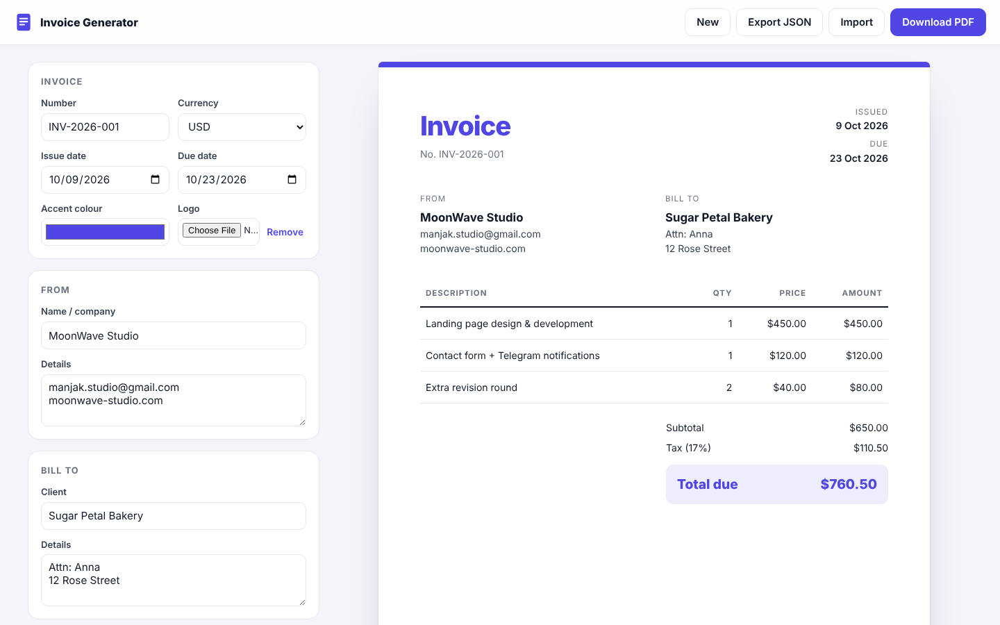

# Invoice Generator

Create a clean, professional invoice in your browser and download it as a PDF. No sign-up, no server: your data never leaves your device.



[Sample PDF output](docs/sample-invoice.pdf)

## Features

- Live A4 preview that updates as you type
- Line items with quantity and price, add and remove rows
- Discount and tax / VAT, totals calculated automatically
- Currency formatting for USD, EUR, GBP, ILS, UAH, RUB
- Your logo and accent colour on the invoice
- **Download PDF** via a print stylesheet tuned for A4 (one clean page, no app chrome)
- Autosave to `localStorage`, so a refresh never loses work
- **New** invoice keeps your details and bumps the number (INV-2026-001 → INV-2026-002)
- Export / import invoices as JSON
- Responsive layout, keyboard friendly, visible focus states

## Tech

Vanilla JavaScript, HTML and CSS. No frameworks, no build step, no dependencies.

## Run locally

Open `index.html` in a browser, or:

```bash
npx serve .
```

## Need something like this?

I build web apps, tools and fast websites for small businesses and startups.

- Studio: [moonwave-studio.com](https://moonwave-studio.com)
- Hire me on [Upwork](https://www.upwork.com/freelancers/~01f7f6a71cc800d79b)

---

© MoonWave. All rights reserved. See [LICENSE](LICENSE).
